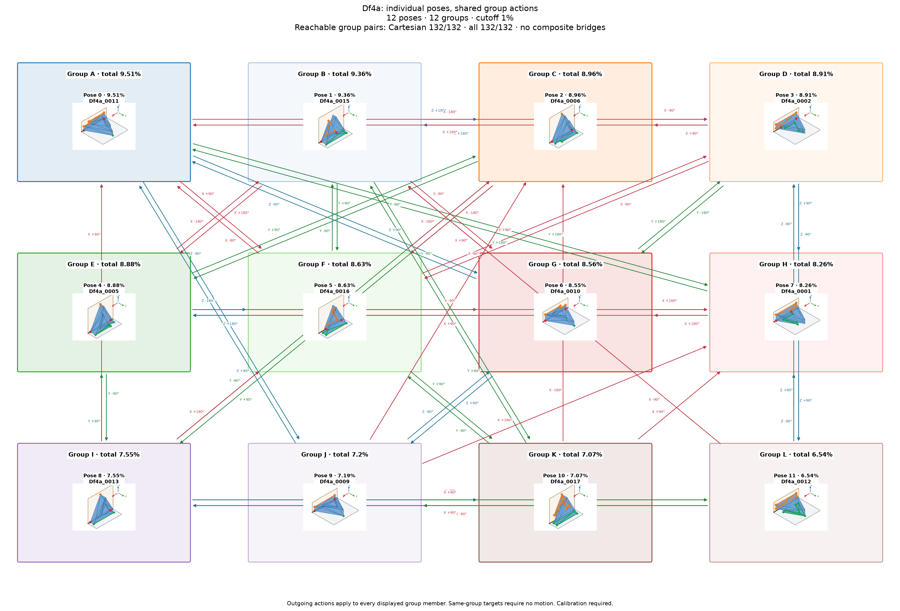

# Df4a: individual poses with shared group actions

Cutoff: **1%**, applied separately to original group totals and individual observation frequencies. Exactly the cutoff qualifies; the source trial denominator is unchanged. Below-cutoff members are not displayed or used as witnesses. Groups without qualifying members are omitted.

| Pose | Original observation | Individual frequency | Count | Group |
| ---: | --- | ---: | ---: | --- |
| 0 | Df4a_0011 | 9.51% | 951 | A |
| 1 | Df4a_0015 | 9.36% | 936 | B |
| 2 | Df4a_0006 | 8.96% | 896 | C |
| 3 | Df4a_0002 | 8.91% | 891 | D |
| 4 | Df4a_0005 | 8.88% | 888 | E |
| 5 | Df4a_0016 | 8.63% | 863 | F |
| 6 | Df4a_0010 | 8.55% | 855 | G |
| 7 | Df4a_0001 | 8.26% | 826 | H |
| 8 | Df4a_0013 | 7.55% | 755 | I |
| 9 | Df4a_0009 | 7.19% | 719 | J |
| 10 | Df4a_0017 | 7.07% | 707 | K |
| 11 | Df4a_0012 | 6.54% | 654 | L |

12 individual poses in 12 groups. Candidate group reachability: **132/132**; Cartesian-only: **132/132**.

Every outgoing action applies to all displayed members of its source group; any qualifying destination member satisfies its target group. A target in the current group requires no motion. There are no internal group transitions and no composite fallback bridges. Ordinary multi-step routes use retained single-axis actions. Disconnected components remain disconnected.

Commands, witnesses, competing landing outcomes, previews and finished routes are in consumer-export version 3. Poses are numbered by individual frequency; stable group identities are separate. Previews use actual witnesses and invent no internal movement. Contact feasibility and settling reliability remain unverified; assigned pressure profiles and explicit source-group calibration are required.

Original observations and memberships remain in `source/`. Historical exports are preserved under `history/` for explicit, hash-checked reimport; numeric group IDs must never be interpreted as new pose IDs. Existing recognition models continue to identify groups. See `manifest.json` and `files.sha256.json`.

The roadmap uses alphabetic group labels in row order (A–Z, then AA onward), numeric pose labels, and straight arrows.
