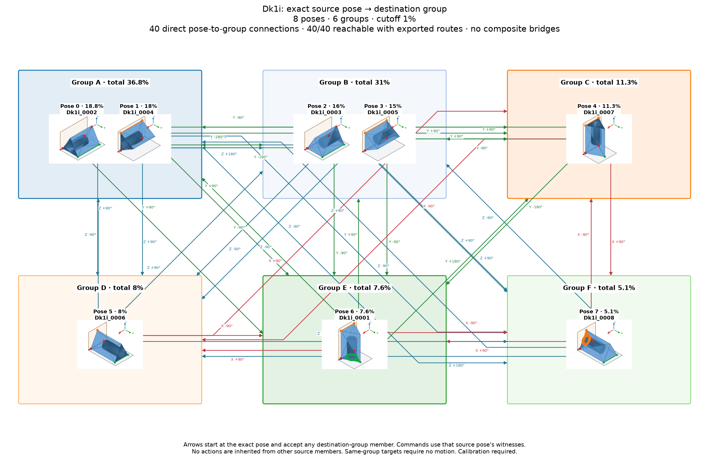

# Dk1i: exact source pose to destination group

Observed simulation poses; geometry supplies untested direct connection candidates.

Minimum frequency: **1%**. Percentages retain the source denominator.

| Roadmap pose | Source pose | Frequency | Count | Group |
| ---: | --- | ---: | ---: | --- |
| 0 | Dk1i_0002 | 18.8% | 188 | A |
| 1 | Dk1i_0004 | 18% | 180 | A |
| 2 | Dk1i_0003 | 16% | 160 | B |
| 3 | Dk1i_0005 | 15% | 150 | B |
| 4 | Dk1i_0007 | 11.3% | 113 | C |
| 5 | Dk1i_0006 | 8% | 80 | D |
| 6 | Dk1i_0001 | 7.6% | 76 | E |
| 7 | Dk1i_0008 | 5.1% | 51 | F |

The legacy `robust` tag is used for stable-target compatibility. It does not assert analytical robustness; rocking and reliability scores are unknown.

Original inputs are in `source/`; generation settings and exclusions are in `manifest.json`.

Exact source pose → accepted destination group: 40 direct connections; 40/40 reachable pairs. Actions are not inherited from other source-group members. Uncertain intermediate groups require another exact observation. No composite bridges. Assigned pressure profiles and explicit source-group calibration are required.

Files: [Dk1i_roadmap.graphml](Dk1i_roadmap.graphml), [Dk1i_roadmap.json](Dk1i_roadmap.json), [Dk1i_roadmap.png](Dk1i_roadmap.png), [Dk1i_roadmap.svg](Dk1i_roadmap.svg), [Dk1i_roadmap.yaml](Dk1i_roadmap.yaml)

## 1,000-drop rerun, 2026-10-19

Generated from grouped poses commit `632b830bd890498e1b07b14d44d97b25f5bba7bb`, using simulator main `2a0c74f5e3eb921cf6e6b5a54102203d01c34ae7` and latest stable main pose anchors `fb055c61c79e789570712f13151aede036c14c51`. 500 mm observation length, belt 100 ± 3 mm/s, contact damping ratio 0.19. Only current individual frequencies determine pose numbers. Pose 0 is **Dk1i_0002** (18.8%).

Arrows apply to the exact source pose and accept any qualifying member of the destination group. No action is inherited from another source member, and no composite bridges are used. Transport pose frequencies and after-stop observations remain separate.

Changed export hashes require explicit reimport; numeric pose IDs do not carry calibration between runs. The prior export is preserved in [history](history/previous_roadmap.json.gz). See [simulation provenance](source/simulation_provenance.json), [validation](source/validation.json), [memberships](membership.csv), and [member assessment curves](source/group_stability.csv).

The roadmap uses alphabetic group labels in row order (A–Z, then AA onward), numeric pose labels, and horizontal, vertical or 45° arrow segments. Arrows attach to pose borders and destination-group borders.
