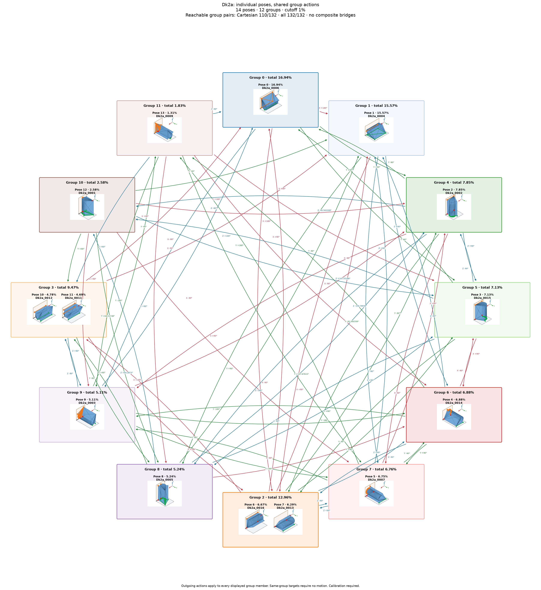

# Dk2a: individual poses with shared group actions

Cutoff: **1%**, applied separately to original group totals and individual observation frequencies. Exactly the cutoff qualifies; the source trial denominator is unchanged. Below-cutoff members are not displayed or used as witnesses. Groups without qualifying members are omitted.

| Pose | Original observation | Individual frequency | Count | Group |
|---:|---|---:|---:|---:|
| 0 | Dk2a_0006 | 16.94% | 1694 | 0 |
| 1 | Dk2a_0004 | 15.57% | 1557 | 1 |
| 2 | Dk2a_0002 | 7.85% | 785 | 4 |
| 3 | Dk2a_0015 | 7.13% | 713 | 5 |
| 4 | Dk2a_0014 | 6.88% | 688 | 6 |
| 5 | Dk2a_0007 | 6.75% | 675 | 7 |
| 6 | Dk2a_0016 | 6.67% | 667 | 2 |
| 7 | Dk2a_0013 | 6.29% | 629 | 2 |
| 8 | Dk2a_0005 | 5.24% | 524 | 8 |
| 9 | Dk2a_0003 | 5.11% | 511 | 9 |
| 10 | Dk2a_0012 | 4.78% | 478 | 3 |
| 11 | Dk2a_0011 | 4.69% | 469 | 3 |
| 12 | Dk2a_0001 | 2.58% | 258 | 10 |
| 13 | Dk2a_0009 | 1.31% | 131 | 11 |

14 individual poses in 12 groups. Candidate group reachability: **132/132**; Cartesian-only: **110/132**.

Every outgoing action applies to all displayed members of its source group; any qualifying destination member satisfies its target group. A target in the current group requires no motion. There are no internal group transitions and no composite fallback bridges. Ordinary multi-step routes use retained single-axis actions. Disconnected components remain disconnected.

Commands, witnesses, competing landing outcomes, previews and finished routes are in consumer-export version 3. Poses are numbered by individual frequency; stable group identities are separate. Previews use actual witnesses and invent no internal movement. Contact feasibility and settling reliability remain unverified; assigned pressure profiles and explicit source-group calibration are required.

Original observations and memberships remain in `source/`. Historical exports are preserved under `history/` for explicit, hash-checked reimport; numeric group IDs must never be interpreted as new pose IDs. Existing recognition models continue to identify groups. See `manifest.json` and `files.sha256.json`.
