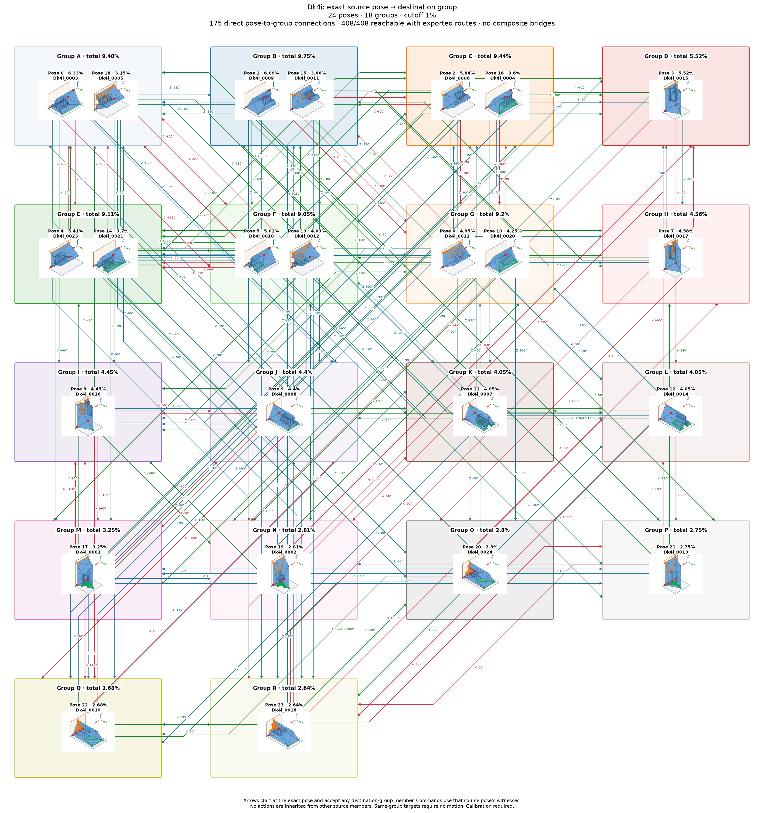

# Dk4i: exact source pose to destination group

Cutoff: **1%**, applied separately to original group totals and individual observation frequencies. Exactly the cutoff qualifies; the source trial denominator is unchanged. Below-cutoff members are not displayed or used as witnesses. Groups without qualifying members are omitted.

| Pose | Original observation | Individual frequency | Count | Group |
| ---: | --- | ---: | ---: | --- |
| 0 | Dk4i_0003 | 6.33% | 633 | A |
| 1 | Dk4i_0009 | 6.09% | 609 | B |
| 2 | Dk4i_0006 | 5.84% | 584 | C |
| 3 | Dk4i_0015 | 5.52% | 552 | D |
| 4 | Dk4i_0023 | 5.41% | 541 | E |
| 5 | Dk4i_0010 | 5.02% | 502 | F |
| 6 | Dk4i_0022 | 4.95% | 495 | G |
| 7 | Dk4i_0017 | 4.56% | 456 | H |
| 8 | Dk4i_0016 | 4.45% | 445 | I |
| 9 | Dk4i_0008 | 4.4% | 440 | J |
| 10 | Dk4i_0020 | 4.25% | 425 | G |
| 11 | Dk4i_0007 | 4.05% | 405 | K |
| 12 | Dk4i_0014 | 4.05% | 405 | L |
| 13 | Dk4i_0012 | 4.03% | 403 | F |
| 14 | Dk4i_0021 | 3.7% | 370 | E |
| 15 | Dk4i_0011 | 3.66% | 366 | B |
| 16 | Dk4i_0004 | 3.6% | 360 | C |
| 17 | Dk4i_0001 | 3.25% | 325 | M |
| 18 | Dk4i_0005 | 3.15% | 315 | A |
| 19 | Dk4i_0002 | 2.81% | 281 | N |
| 20 | Dk4i_0024 | 2.8% | 280 | O |
| 21 | Dk4i_0013 | 2.75% | 275 | P |
| 22 | Dk4i_0019 | 2.68% | 268 | Q |
| 23 | Dk4i_0018 | 2.64% | 264 | R |

24 individual poses in 18 groups. Exact-source pose-to-group reachability: **408/408**; **175** pairs have direct candidates.

Each transition starts at an exact individual pose and accepts any qualifying member of its destination group. Actions from other source members are not inherited. A target in the current group requires no motion. There are no internal group transitions and no composite fallback bridges. Routes continue automatically only through singleton arrival groups; a multi-member arrival requires another exact pose observation. Disconnected components remain disconnected.

Commands, witnesses, competing landing outcomes, previews and finished routes are in consumer-export version 3. Poses are numbered by individual frequency; stable group identities are separate. Previews use actual witnesses and invent no internal movement. Contact feasibility and settling reliability remain unverified; assigned pressure profiles and explicit source-group calibration are required.

Original observations and memberships remain in `source/`. Historical exports are preserved under `history/` for explicit, hash-checked reimport; numeric group IDs must never be interpreted as new pose IDs. Existing recognition models continue to identify groups. See `manifest.json` and `files.sha256.json`.

The roadmap uses alphabetic group labels in row order (A–Z, then AA onward), numeric pose labels, and horizontal, vertical or 45° arrow segments. Arrows attach to pose borders and destination-group borders.

Changed export hashes require explicit reimport. Former group-wide choices need fresh exact-source qualification. The previous export is preserved in `history/before_pose_to_group_74fcb40.json.gz`.
