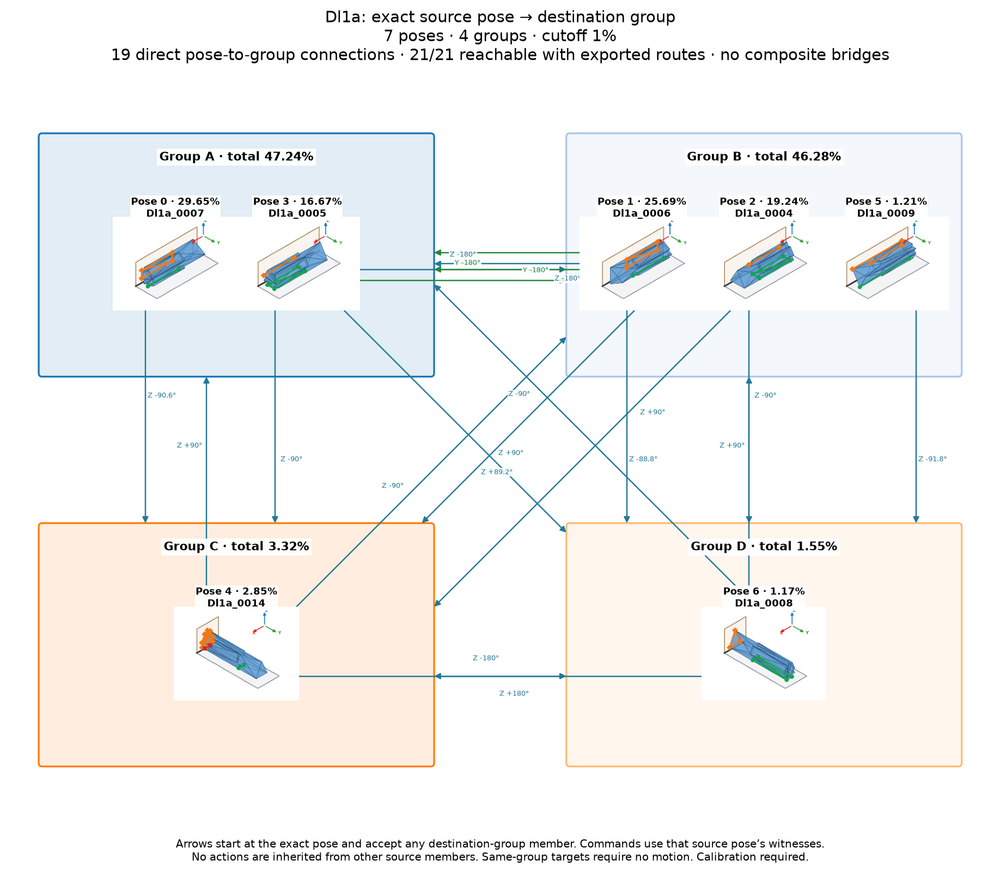

# Dl1a: exact source pose to destination group

Cutoff: **1%**, applied separately to original group totals and individual observation frequencies. Exactly the cutoff qualifies; the source trial denominator is unchanged. Below-cutoff members are not displayed or used as witnesses. Groups without qualifying members are omitted.

| Pose | Original observation | Individual frequency | Count | Group |
| ---: | --- | ---: | ---: | --- |
| 0 | Dl1a_0007 | 29.65% | 2965 | A |
| 1 | Dl1a_0006 | 25.69% | 2569 | B |
| 2 | Dl1a_0004 | 19.24% | 1924 | B |
| 3 | Dl1a_0005 | 16.67% | 1667 | A |
| 4 | Dl1a_0014 | 2.85% | 285 | C |
| 5 | Dl1a_0009 | 1.21% | 121 | B |
| 6 | Dl1a_0008 | 1.17% | 117 | D |

7 individual poses in 4 groups. Exact-source pose-to-group reachability: **21/21**; **19** pairs have direct candidates.

Each transition starts at an exact individual pose and accepts any qualifying member of its destination group. Actions from other source members are not inherited. A target in the current group requires no motion. There are no internal group transitions and no composite fallback bridges. Routes continue automatically only through singleton arrival groups; a multi-member arrival requires another exact pose observation. Disconnected components remain disconnected.

Commands, witnesses, competing landing outcomes, previews and finished routes are in consumer-export version 3. Poses are numbered by individual frequency; stable group identities are separate. Previews use actual witnesses and invent no internal movement. Contact feasibility and settling reliability remain unverified; assigned pressure profiles and explicit source-group calibration are required.

Original observations and memberships remain in `source/`. Historical exports are preserved under `history/` for explicit, hash-checked reimport; numeric group IDs must never be interpreted as new pose IDs. Existing recognition models continue to identify groups. See `manifest.json` and `files.sha256.json`.

The roadmap uses alphabetic group labels in row order (A–Z, then AA onward), numeric pose labels, and horizontal, vertical or 45° arrow segments. Arrows attach to pose borders and destination-group borders.

Changed export hashes require explicit reimport. Former group-wide choices need fresh exact-source qualification. The previous export is preserved in `history/before_pose_to_group_74fcb40.json.gz`.
