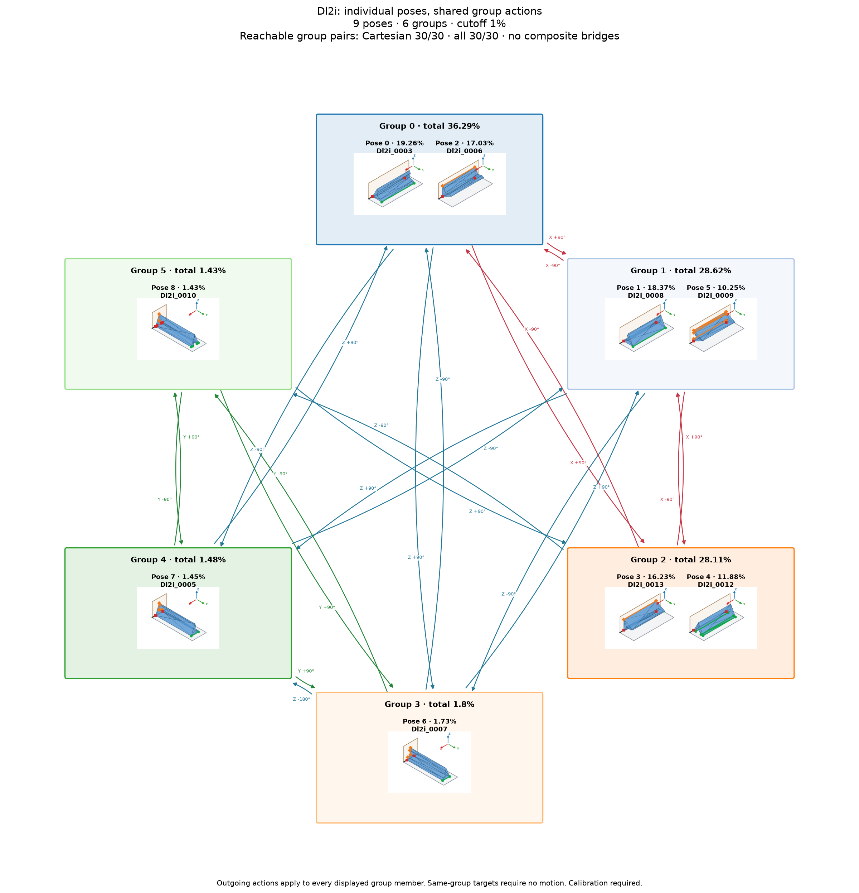

# Dl2i: individual poses with shared group actions

Cutoff: **1%**, applied separately to original group totals and individual observation frequencies. Exactly the cutoff qualifies; the source trial denominator is unchanged. Below-cutoff members are not displayed or used as witnesses. Groups without qualifying members are omitted.

| Pose | Original observation | Individual frequency | Count | Group |
|---:|---|---:|---:|---:|
| 0 | Dl2i_0003 | 19.26% | 1926 | 0 |
| 1 | Dl2i_0008 | 18.37% | 1837 | 1 |
| 2 | Dl2i_0006 | 17.03% | 1703 | 0 |
| 3 | Dl2i_0013 | 16.23% | 1623 | 2 |
| 4 | Dl2i_0012 | 11.88% | 1188 | 2 |
| 5 | Dl2i_0009 | 10.25% | 1025 | 1 |
| 6 | Dl2i_0007 | 1.73% | 173 | 3 |
| 7 | Dl2i_0005 | 1.45% | 145 | 4 |
| 8 | Dl2i_0010 | 1.43% | 143 | 5 |

9 individual poses in 6 groups. Candidate group reachability: **30/30**; Cartesian-only: **30/30**.

Every outgoing action applies to all displayed members of its source group; any qualifying destination member satisfies its target group. A target in the current group requires no motion. There are no internal group transitions and no composite fallback bridges. Ordinary multi-step routes use retained single-axis actions. Disconnected components remain disconnected.

Commands, witnesses, competing landing outcomes, previews and finished routes are in consumer-export version 3. Poses are numbered by individual frequency; stable group identities are separate. Previews use actual witnesses and invent no internal movement. Contact feasibility and settling reliability remain unverified; assigned pressure profiles and explicit source-group calibration are required.

Original observations and memberships remain in `source/`. Historical exports are preserved under `history/` for explicit, hash-checked reimport; numeric group IDs must never be interpreted as new pose IDs. Existing recognition models continue to identify groups. See `manifest.json` and `files.sha256.json`.
