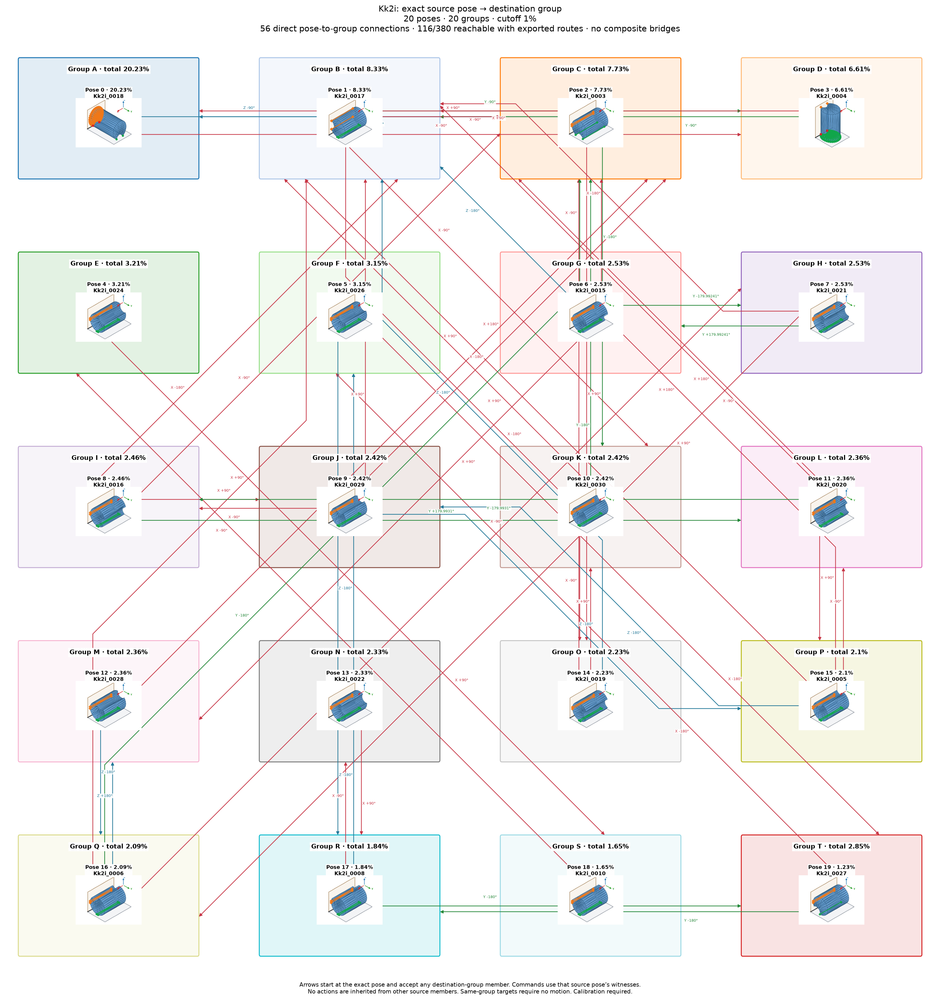

# Kk2i: exact source pose to destination group

Cutoff: **1%**, applied separately to original group totals and individual observation frequencies. Exactly the cutoff qualifies; the source trial denominator is unchanged. Below-cutoff members are not displayed or used as witnesses. Groups without qualifying members are omitted.

| Pose | Original observation | Individual frequency | Count | Group |
| ---: | --- | ---: | ---: | --- |
| 0 | Kk2i_0018 | 20.23% | 2023 | A |
| 1 | Kk2i_0017 | 8.33% | 833 | B |
| 2 | Kk2i_0003 | 7.73% | 773 | C |
| 3 | Kk2i_0004 | 6.61% | 661 | D |
| 4 | Kk2i_0024 | 3.21% | 321 | E |
| 5 | Kk2i_0026 | 3.15% | 315 | F |
| 6 | Kk2i_0015 | 2.53% | 253 | G |
| 7 | Kk2i_0021 | 2.53% | 253 | H |
| 8 | Kk2i_0016 | 2.46% | 246 | I |
| 9 | Kk2i_0029 | 2.42% | 242 | J |
| 10 | Kk2i_0030 | 2.42% | 242 | K |
| 11 | Kk2i_0020 | 2.36% | 236 | L |
| 12 | Kk2i_0028 | 2.36% | 236 | M |
| 13 | Kk2i_0022 | 2.33% | 233 | N |
| 14 | Kk2i_0019 | 2.23% | 223 | O |
| 15 | Kk2i_0005 | 2.1% | 210 | P |
| 16 | Kk2i_0006 | 2.09% | 209 | Q |
| 17 | Kk2i_0008 | 1.84% | 184 | R |
| 18 | Kk2i_0010 | 1.65% | 165 | S |
| 19 | Kk2i_0027 | 1.23% | 123 | T |

20 individual poses in 20 groups. Exact-source pose-to-group reachability: **116/380**; **56** pairs have direct candidates.

Each transition starts at an exact individual pose and accepts any qualifying member of its destination group. Actions from other source members are not inherited. A target in the current group requires no motion. There are no internal group transitions and no composite fallback bridges. Routes continue automatically only through singleton arrival groups; a multi-member arrival requires another exact pose observation. Disconnected components remain disconnected.

Commands, witnesses, competing landing outcomes, previews and finished routes are in consumer-export version 3. Poses are numbered by individual frequency; stable group identities are separate. Previews use actual witnesses and invent no internal movement. Contact feasibility and settling reliability remain unverified; assigned pressure profiles and explicit source-group calibration are required.

Original observations and memberships remain in `source/`. Historical exports are preserved under `history/` for explicit, hash-checked reimport; numeric group IDs must never be interpreted as new pose IDs. Existing recognition models continue to identify groups. See `manifest.json` and `files.sha256.json`.

The roadmap uses alphabetic group labels in row order (A–Z, then AA onward), numeric pose labels, and horizontal, vertical or 45° arrow segments. Arrows attach to pose borders and destination-group borders.

Changed export hashes require explicit reimport. Former group-wide choices need fresh exact-source qualification. The previous export is preserved in `history/before_pose_to_group_74fcb40.json.gz`.
