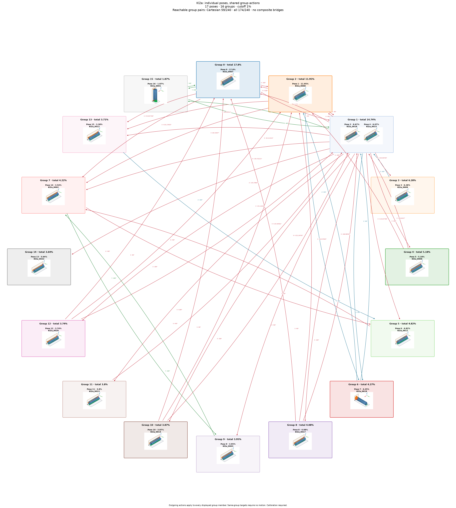

# Kl2a: individual poses with shared group actions

Cutoff: **1%**, applied separately to original group totals and individual observation frequencies. Exactly the cutoff qualifies; the source trial denominator is unchanged. Below-cutoff members are not displayed or used as witnesses. Groups without qualifying members are omitted.

| Pose | Original observation | Individual frequency | Count | Group |
|---:|---|---:|---:|---:|
| 0 | Kl2a_0007 | 17.8% | 1780 | 0 |
| 1 | Kl2a_0008 | 11.95% | 1195 | 2 |
| 2 | Kl2a_0018 | 8.67% | 867 | 1 |
| 3 | Kl2a_0009 | 6.28% | 628 | 3 |
| 4 | Kl2a_0015 | 6.07% | 607 | 1 |
| 5 | Kl2a_0006 | 5.18% | 518 | 4 |
| 6 | Kl2a_0011 | 4.82% | 482 | 5 |
| 7 | Kl2a_0019 | 4.25% | 425 | 6 |
| 8 | Kl2a_0017 | 4.08% | 408 | 8 |
| 9 | Kl2a_0003 | 3.95% | 395 | 9 |
| 10 | Kl2a_0014 | 3.87% | 387 | 10 |
| 11 | Kl2a_0013 | 3.8% | 380 | 11 |
| 12 | Kl2a_0020 | 3.74% | 374 | 12 |
| 13 | Kl2a_0022 | 3.64% | 364 | 14 |
| 14 | Kl2a_0002 | 3.54% | 354 | 7 |
| 15 | Kl2a_0012 | 3.38% | 338 | 13 |
| 16 | Kl2a_0001 | 1.87% | 187 | 15 |

17 individual poses in 16 groups. Candidate group reachability: **174/240**; Cartesian-only: **59/240**.

Every outgoing action applies to all displayed members of its source group; any qualifying destination member satisfies its target group. A target in the current group requires no motion. There are no internal group transitions and no composite fallback bridges. Ordinary multi-step routes use retained single-axis actions. Disconnected components remain disconnected.

Commands, witnesses, competing landing outcomes, previews and finished routes are in consumer-export version 3. Poses are numbered by individual frequency; stable group identities are separate. Previews use actual witnesses and invent no internal movement. Contact feasibility and settling reliability remain unverified; assigned pressure profiles and explicit source-group calibration are required.

Original observations and memberships remain in `source/`. Historical exports are preserved under `history/` for explicit, hash-checked reimport; numeric group IDs must never be interpreted as new pose IDs. Existing recognition models continue to identify groups. See `manifest.json` and `files.sha256.json`.
