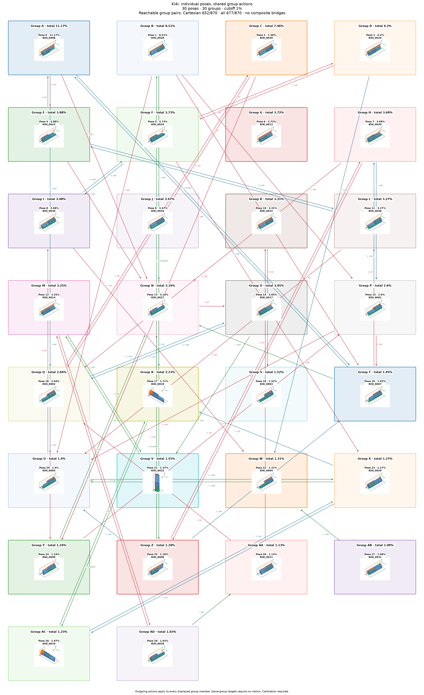

# Kl4i: individual poses with shared group actions

Cutoff: **1%**, applied separately to original group totals and individual observation frequencies. Exactly the cutoff qualifies; the source trial denominator is unchanged. Below-cutoff members are not displayed or used as witnesses. Groups without qualifying members are omitted.

| Pose | Original observation | Individual frequency | Count | Group |
| ---: | --- | ---: | ---: | --- |
| 0 | Kl4i_0008 | 11.17% | 1117 | A |
| 1 | Kl4i_0028 | 8.51% | 851 | B |
| 2 | Kl4i_0030 | 7.46% | 746 | C |
| 3 | Kl4i_0010 | 4.2% | 420 | D |
| 4 | Kl4i_0023 | 3.88% | 388 | E |
| 5 | Kl4i_0024 | 3.73% | 373 | F |
| 6 | Kl4i_0012 | 3.72% | 372 | G |
| 7 | Kl4i_0020 | 3.69% | 369 | H |
| 8 | Kl4i_0036 | 3.48% | 348 | I |
| 9 | Kl4i_0034 | 3.47% | 347 | J |
| 10 | Kl4i_0032 | 3.31% | 331 | K |
| 11 | Kl4i_0038 | 3.27% | 327 | L |
| 12 | Kl4i_0014 | 3.25% | 325 | M |
| 13 | Kl4i_0027 | 3.16% | 316 | N |
| 14 | Kl4i_0017 | 3.05% | 305 | O |
| 15 | Kl4i_0001 | 2.6% | 260 | P |
| 16 | Kl4i_0002 | 2.04% | 204 | Q |
| 17 | Kl4i_0018 | 1.71% | 171 | R |
| 18 | Kl4i_0003 | 1.52% | 152 | S |
| 19 | Kl4i_0007 | 1.45% | 145 | T |
| 20 | Kl4i_0005 | 1.4% | 140 | U |
| 21 | Kl4i_0022 | 1.37% | 137 | V |
| 22 | Kl4i_0004 | 1.31% | 131 | W |
| 23 | Kl4i_0029 | 1.27% | 127 | X |
| 24 | Kl4i_0009 | 1.24% | 124 | Y |
| 25 | Kl4i_0006 | 1.18% | 118 | Z |
| 26 | Kl4i_0011 | 1.13% | 113 | AA |
| 27 | Kl4i_0031 | 1.09% | 109 | AB |
| 28 | Kl4i_0019 | 1.07% | 107 | AC |
| 29 | Kl4i_0026 | 1.03% | 103 | AD |

30 individual poses in 30 groups. Candidate group reachability: **677/870**; Cartesian-only: **652/870**.

Every outgoing action applies to all displayed members of its source group; any qualifying destination member satisfies its target group. A target in the current group requires no motion. There are no internal group transitions and no composite fallback bridges. Ordinary multi-step routes use retained single-axis actions. Disconnected components remain disconnected.

Commands, witnesses, competing landing outcomes, previews and finished routes are in consumer-export version 3. Poses are numbered by individual frequency; stable group identities are separate. Previews use actual witnesses and invent no internal movement. Contact feasibility and settling reliability remain unverified; assigned pressure profiles and explicit source-group calibration are required.

Original observations and memberships remain in `source/`. Historical exports are preserved under `history/` for explicit, hash-checked reimport; numeric group IDs must never be interpreted as new pose IDs. Existing recognition models continue to identify groups. See `manifest.json` and `files.sha256.json`.

The roadmap uses alphabetic group labels in row order (A–Z, then AA onward), numeric pose labels, and straight arrows.
