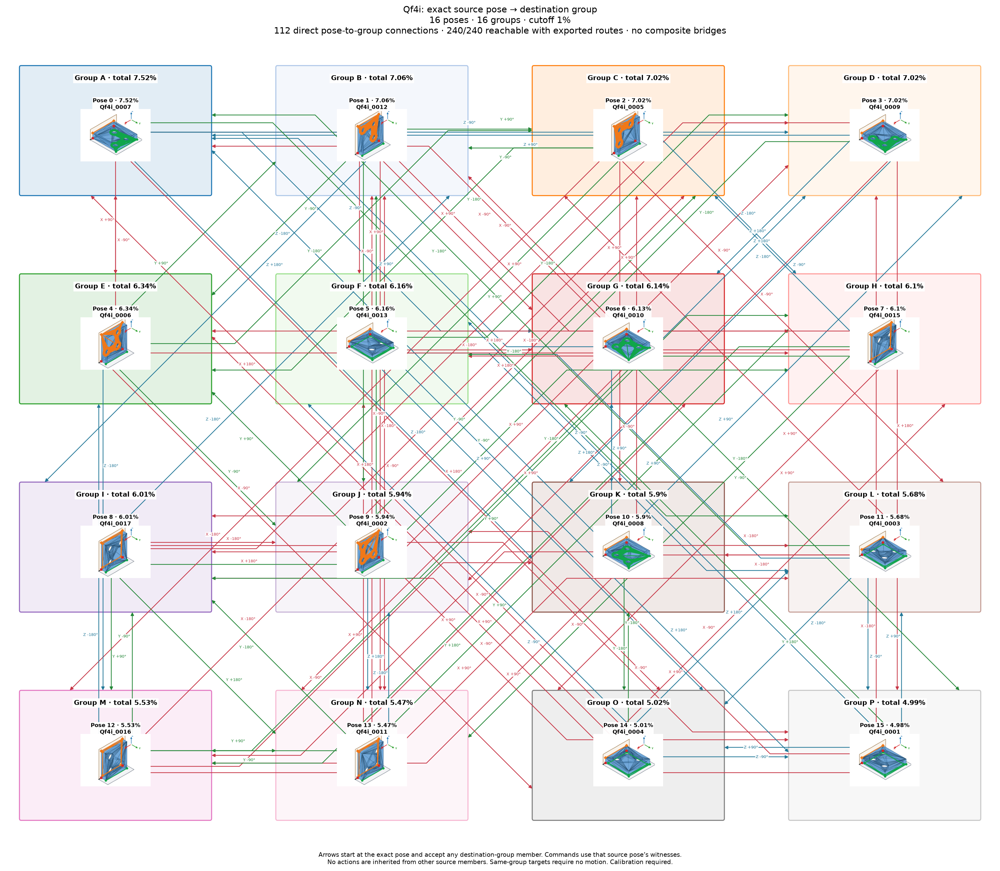

# Qf4i: exact source pose to destination group

Cutoff: **1%**, applied separately to original group totals and individual observation frequencies. Exactly the cutoff qualifies; the source trial denominator is unchanged. Below-cutoff members are not displayed or used as witnesses. Groups without qualifying members are omitted.

| Pose | Original observation | Individual frequency | Count | Group |
| ---: | --- | ---: | ---: | --- |
| 0 | Qf4i_0007 | 7.52% | 752 | A |
| 1 | Qf4i_0012 | 7.06% | 706 | B |
| 2 | Qf4i_0005 | 7.02% | 702 | C |
| 3 | Qf4i_0009 | 7.02% | 702 | D |
| 4 | Qf4i_0006 | 6.34% | 634 | E |
| 5 | Qf4i_0013 | 6.16% | 616 | F |
| 6 | Qf4i_0010 | 6.13% | 613 | G |
| 7 | Qf4i_0015 | 6.1% | 610 | H |
| 8 | Qf4i_0017 | 6.01% | 601 | I |
| 9 | Qf4i_0002 | 5.94% | 594 | J |
| 10 | Qf4i_0008 | 5.9% | 590 | K |
| 11 | Qf4i_0003 | 5.68% | 568 | L |
| 12 | Qf4i_0016 | 5.53% | 553 | M |
| 13 | Qf4i_0011 | 5.47% | 547 | N |
| 14 | Qf4i_0004 | 5.01% | 501 | O |
| 15 | Qf4i_0001 | 4.98% | 498 | P |

16 individual poses in 16 groups. Exact-source pose-to-group reachability: **240/240**; **112** pairs have direct candidates.

Each transition starts at an exact individual pose and accepts any qualifying member of its destination group. Actions from other source members are not inherited. A target in the current group requires no motion. There are no internal group transitions and no composite fallback bridges. Routes continue automatically only through singleton arrival groups; a multi-member arrival requires another exact pose observation. Disconnected components remain disconnected.

Commands, witnesses, competing landing outcomes, previews and finished routes are in consumer-export version 3. Poses are numbered by individual frequency; stable group identities are separate. Previews use actual witnesses and invent no internal movement. Contact feasibility and settling reliability remain unverified; assigned pressure profiles and explicit source-group calibration are required.

Original observations and memberships remain in `source/`. Historical exports are preserved under `history/` for explicit, hash-checked reimport; numeric group IDs must never be interpreted as new pose IDs. Existing recognition models continue to identify groups. See `manifest.json` and `files.sha256.json`.

The roadmap uses alphabetic group labels in row order (A–Z, then AA onward), numeric pose labels, and horizontal, vertical or 45° arrow segments. Arrows attach to pose borders and destination-group borders.

Changed export hashes require explicit reimport. Former group-wide choices need fresh exact-source qualification. The previous export is preserved in `history/before_pose_to_group_74fcb40.json.gz`.
