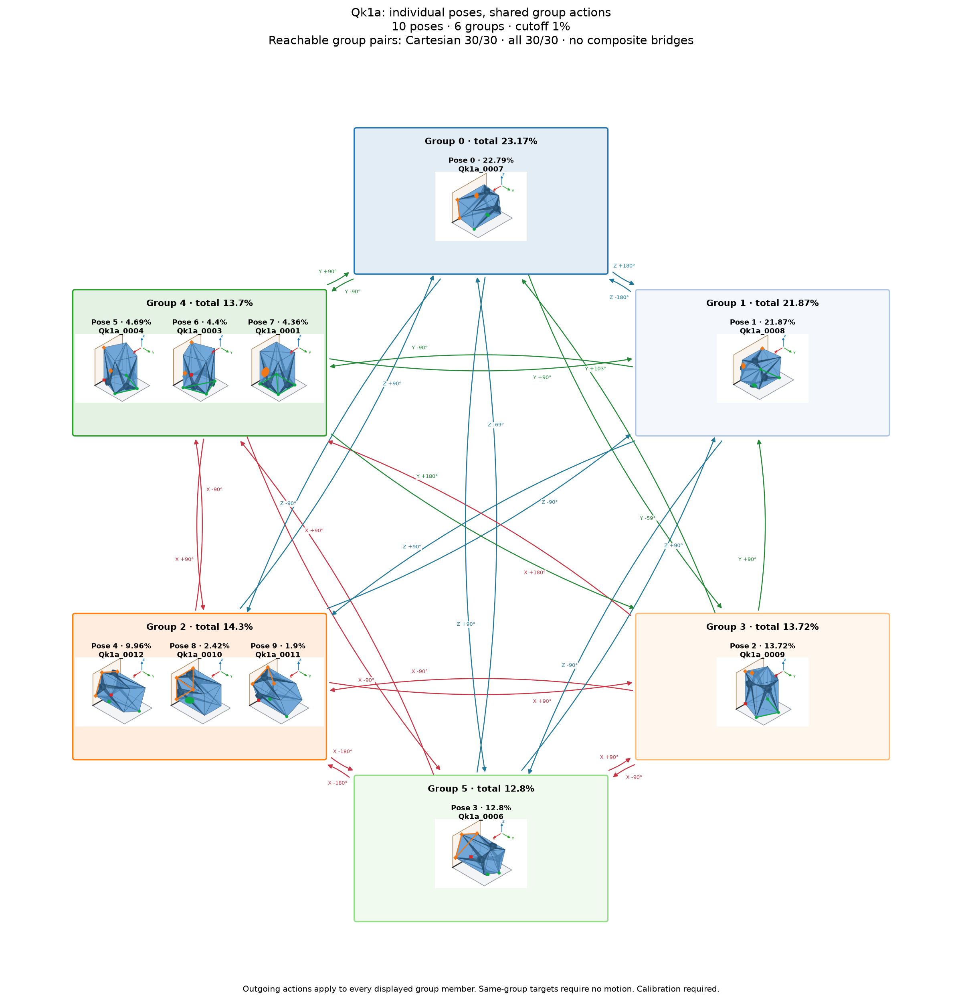

# Qk1a: individual poses with shared group actions

Cutoff: **1%**, applied separately to original group totals and individual observation frequencies. Exactly the cutoff qualifies; the source trial denominator is unchanged. Below-cutoff members are not displayed or used as witnesses. Groups without qualifying members are omitted.

| Pose | Original observation | Individual frequency | Count | Group |
|---:|---|---:|---:|---:|
| 0 | Qk1a_0007 | 22.79% | 2279 | 0 |
| 1 | Qk1a_0008 | 21.87% | 2187 | 1 |
| 2 | Qk1a_0009 | 13.72% | 1372 | 3 |
| 3 | Qk1a_0006 | 12.8% | 1280 | 5 |
| 4 | Qk1a_0012 | 9.96% | 996 | 2 |
| 5 | Qk1a_0004 | 4.69% | 469 | 4 |
| 6 | Qk1a_0003 | 4.4% | 440 | 4 |
| 7 | Qk1a_0001 | 4.36% | 436 | 4 |
| 8 | Qk1a_0010 | 2.42% | 242 | 2 |
| 9 | Qk1a_0011 | 1.9% | 190 | 2 |

10 individual poses in 6 groups. Candidate group reachability: **30/30**; Cartesian-only: **30/30**.

Every outgoing action applies to all displayed members of its source group; any qualifying destination member satisfies its target group. A target in the current group requires no motion. There are no internal group transitions and no composite fallback bridges. Ordinary multi-step routes use retained single-axis actions. Disconnected components remain disconnected.

Commands, witnesses, competing landing outcomes, previews and finished routes are in consumer-export version 3. Poses are numbered by individual frequency; stable group identities are separate. Previews use actual witnesses and invent no internal movement. Contact feasibility and settling reliability remain unverified; assigned pressure profiles and explicit source-group calibration are required.

Original observations and memberships remain in `source/`. Historical exports are preserved under `history/` for explicit, hash-checked reimport; numeric group IDs must never be interpreted as new pose IDs. Existing recognition models continue to identify groups. See `manifest.json` and `files.sha256.json`.
