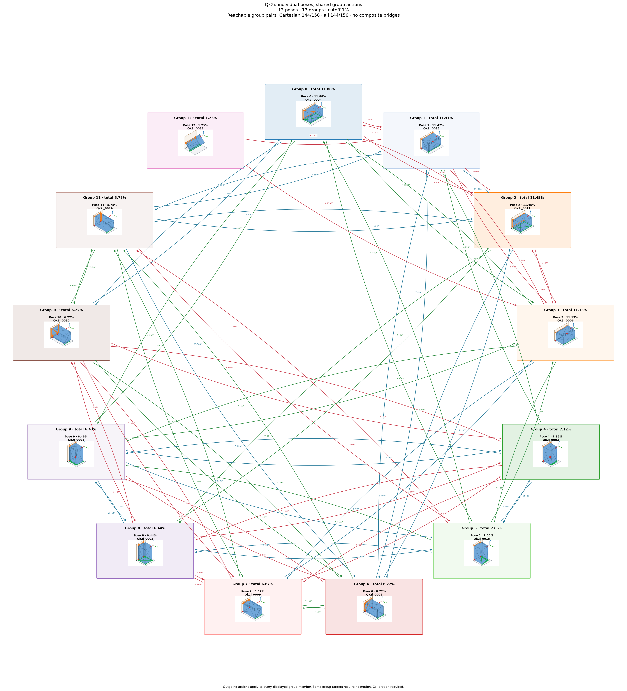

# Qk2i: individual poses with shared group actions

Cutoff: **1%**, applied separately to original group totals and individual observation frequencies. Exactly the cutoff qualifies; the source trial denominator is unchanged. Below-cutoff members are not displayed or used as witnesses. Groups without qualifying members are omitted.

| Pose | Original observation | Individual frequency | Count | Group |
|---:|---|---:|---:|---:|
| 0 | Qk2i_0004 | 11.88% | 1188 | 0 |
| 1 | Qk2i_0012 | 11.47% | 1147 | 1 |
| 2 | Qk2i_0011 | 11.45% | 1145 | 2 |
| 3 | Qk2i_0006 | 11.13% | 1113 | 3 |
| 4 | Qk2i_0003 | 7.12% | 712 | 4 |
| 5 | Qk2i_0015 | 7.05% | 705 | 5 |
| 6 | Qk2i_0005 | 6.72% | 672 | 6 |
| 7 | Qk2i_0009 | 6.67% | 667 | 7 |
| 8 | Qk2i_0002 | 6.44% | 644 | 8 |
| 9 | Qk2i_0001 | 6.43% | 643 | 9 |
| 10 | Qk2i_0010 | 6.22% | 622 | 10 |
| 11 | Qk2i_0014 | 5.75% | 575 | 11 |
| 12 | Qk2i_0013 | 1.25% | 125 | 12 |

13 individual poses in 13 groups. Candidate group reachability: **144/156**; Cartesian-only: **144/156**.

Every outgoing action applies to all displayed members of its source group; any qualifying destination member satisfies its target group. A target in the current group requires no motion. There are no internal group transitions and no composite fallback bridges. Ordinary multi-step routes use retained single-axis actions. Disconnected components remain disconnected.

Commands, witnesses, competing landing outcomes, previews and finished routes are in consumer-export version 3. Poses are numbered by individual frequency; stable group identities are separate. Previews use actual witnesses and invent no internal movement. Contact feasibility and settling reliability remain unverified; assigned pressure profiles and explicit source-group calibration are required.

Original observations and memberships remain in `source/`. Historical exports are preserved under `history/` for explicit, hash-checked reimport; numeric group IDs must never be interpreted as new pose IDs. Existing recognition models continue to identify groups. See `manifest.json` and `files.sha256.json`.
