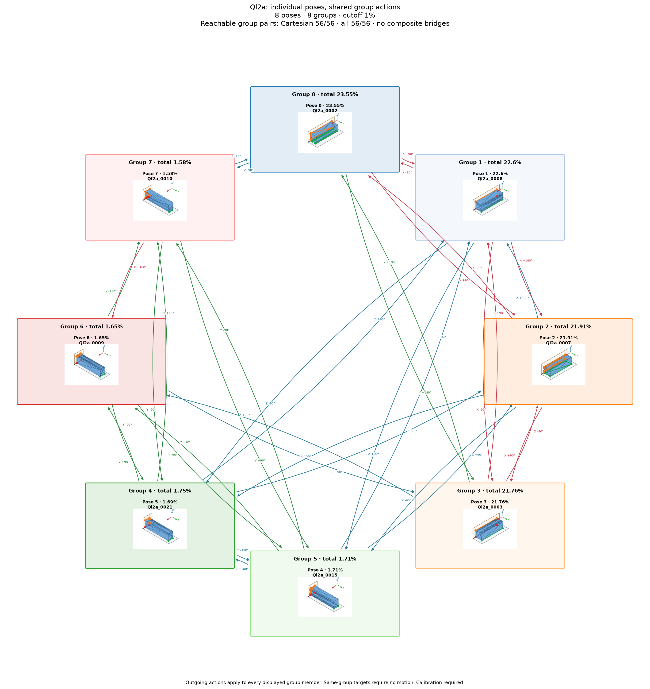

# Ql2a: individual poses with shared group actions

Cutoff: **1%**, applied separately to original group totals and individual observation frequencies. Exactly the cutoff qualifies; the source trial denominator is unchanged. Below-cutoff members are not displayed or used as witnesses. Groups without qualifying members are omitted.

| Pose | Original observation | Individual frequency | Count | Group |
|---:|---|---:|---:|---:|
| 0 | Ql2a_0002 | 23.55% | 2355 | 0 |
| 1 | Ql2a_0008 | 22.6% | 2260 | 1 |
| 2 | Ql2a_0007 | 21.91% | 2191 | 2 |
| 3 | Ql2a_0003 | 21.76% | 2176 | 3 |
| 4 | Ql2a_0015 | 1.71% | 171 | 5 |
| 5 | Ql2a_0021 | 1.69% | 169 | 4 |
| 6 | Ql2a_0009 | 1.65% | 165 | 6 |
| 7 | Ql2a_0010 | 1.58% | 158 | 7 |

8 individual poses in 8 groups. Candidate group reachability: **56/56**; Cartesian-only: **56/56**.

Every outgoing action applies to all displayed members of its source group; any qualifying destination member satisfies its target group. A target in the current group requires no motion. There are no internal group transitions and no composite fallback bridges. Ordinary multi-step routes use retained single-axis actions. Disconnected components remain disconnected.

Commands, witnesses, competing landing outcomes, previews and finished routes are in consumer-export version 3. Poses are numbered by individual frequency; stable group identities are separate. Previews use actual witnesses and invent no internal movement. Contact feasibility and settling reliability remain unverified; assigned pressure profiles and explicit source-group calibration are required.

Original observations and memberships remain in `source/`. Historical exports are preserved under `history/` for explicit, hash-checked reimport; numeric group IDs must never be interpreted as new pose IDs. Existing recognition models continue to identify groups. See `manifest.json` and `files.sha256.json`.
