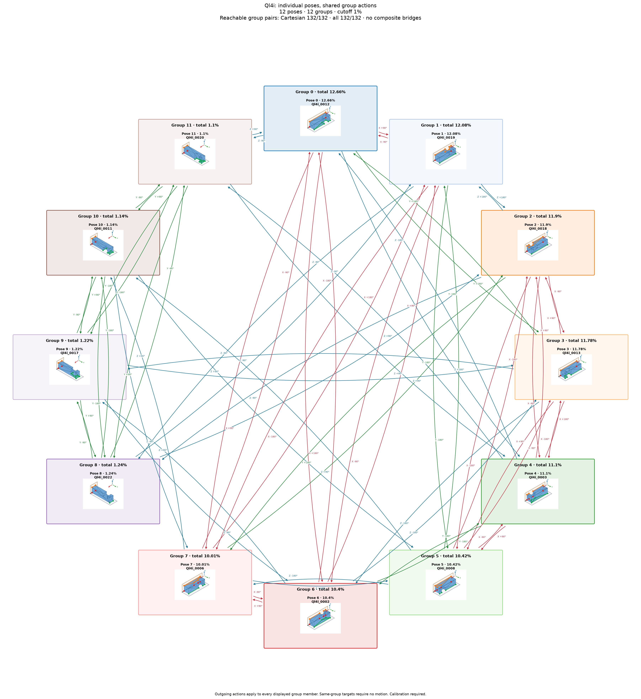

# Ql4i: individual poses with shared group actions

Cutoff: **1%**, applied separately to original group totals and individual observation frequencies. Exactly the cutoff qualifies; the source trial denominator is unchanged. Below-cutoff members are not displayed or used as witnesses. Groups without qualifying members are omitted.

| Pose | Original observation | Individual frequency | Count | Group |
|---:|---|---:|---:|---:|
| 0 | Ql4i_0012 | 12.66% | 1266 | 0 |
| 1 | Ql4i_0019 | 12.08% | 1208 | 1 |
| 2 | Ql4i_0018 | 11.9% | 1190 | 2 |
| 3 | Ql4i_0013 | 11.78% | 1178 | 3 |
| 4 | Ql4i_0003 | 11.1% | 1110 | 4 |
| 5 | Ql4i_0008 | 10.42% | 1042 | 5 |
| 6 | Ql4i_0002 | 10.4% | 1040 | 6 |
| 7 | Ql4i_0006 | 10.01% | 1001 | 7 |
| 8 | Ql4i_0022 | 1.24% | 124 | 8 |
| 9 | Ql4i_0017 | 1.22% | 122 | 9 |
| 10 | Ql4i_0011 | 1.14% | 114 | 10 |
| 11 | Ql4i_0020 | 1.1% | 110 | 11 |

12 individual poses in 12 groups. Candidate group reachability: **132/132**; Cartesian-only: **132/132**.

Every outgoing action applies to all displayed members of its source group; any qualifying destination member satisfies its target group. A target in the current group requires no motion. There are no internal group transitions and no composite fallback bridges. Ordinary multi-step routes use retained single-axis actions. Disconnected components remain disconnected.

Commands, witnesses, competing landing outcomes, previews and finished routes are in consumer-export version 3. Poses are numbered by individual frequency; stable group identities are separate. Previews use actual witnesses and invent no internal movement. Contact feasibility and settling reliability remain unverified; assigned pressure profiles and explicit source-group calibration are required.

Original observations and memberships remain in `source/`. Historical exports are preserved under `history/` for explicit, hash-checked reimport; numeric group IDs must never be interpreted as new pose IDs. Existing recognition models continue to identify groups. See `manifest.json` and `files.sha256.json`.
