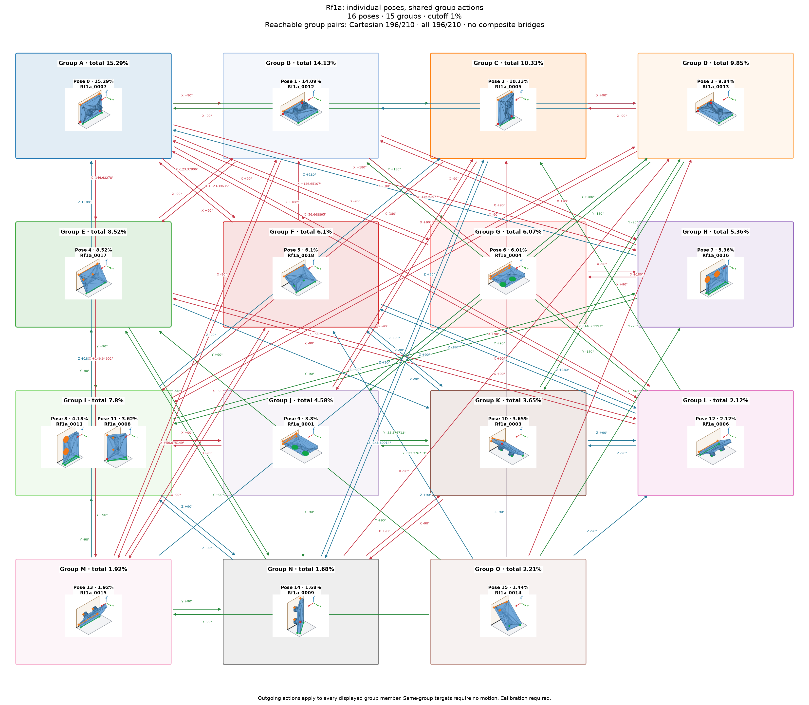

# Rf1a: individual poses with shared group actions

Cutoff: **1%**, applied separately to original group totals and individual observation frequencies. Exactly the cutoff qualifies; the source trial denominator is unchanged. Below-cutoff members are not displayed or used as witnesses. Groups without qualifying members are omitted.

| Pose | Original observation | Individual frequency | Count | Group |
| ---: | --- | ---: | ---: | --- |
| 0 | Rf1a_0007 | 15.29% | 1529 | A |
| 1 | Rf1a_0012 | 14.09% | 1409 | B |
| 2 | Rf1a_0005 | 10.33% | 1033 | C |
| 3 | Rf1a_0013 | 9.84% | 984 | D |
| 4 | Rf1a_0017 | 8.52% | 852 | E |
| 5 | Rf1a_0018 | 6.1% | 610 | F |
| 6 | Rf1a_0004 | 6.01% | 601 | G |
| 7 | Rf1a_0016 | 5.36% | 536 | H |
| 8 | Rf1a_0011 | 4.18% | 418 | I |
| 9 | Rf1a_0001 | 3.8% | 380 | J |
| 10 | Rf1a_0003 | 3.65% | 365 | K |
| 11 | Rf1a_0008 | 3.62% | 362 | I |
| 12 | Rf1a_0006 | 2.12% | 212 | L |
| 13 | Rf1a_0015 | 1.92% | 192 | M |
| 14 | Rf1a_0009 | 1.68% | 168 | N |
| 15 | Rf1a_0014 | 1.44% | 144 | O |

16 individual poses in 15 groups. Candidate group reachability: **196/210**; Cartesian-only: **196/210**.

Every outgoing action applies to all displayed members of its source group; any qualifying destination member satisfies its target group. A target in the current group requires no motion. There are no internal group transitions and no composite fallback bridges. Ordinary multi-step routes use retained single-axis actions. Disconnected components remain disconnected.

Commands, witnesses, competing landing outcomes, previews and finished routes are in consumer-export version 3. Poses are numbered by individual frequency; stable group identities are separate. Previews use actual witnesses and invent no internal movement. Contact feasibility and settling reliability remain unverified; assigned pressure profiles and explicit source-group calibration are required.

Original observations and memberships remain in `source/`. Historical exports are preserved under `history/` for explicit, hash-checked reimport; numeric group IDs must never be interpreted as new pose IDs. Existing recognition models continue to identify groups. See `manifest.json` and `files.sha256.json`.

The roadmap uses alphabetic group labels in row order (A–Z, then AA onward), numeric pose labels, and straight arrows.
