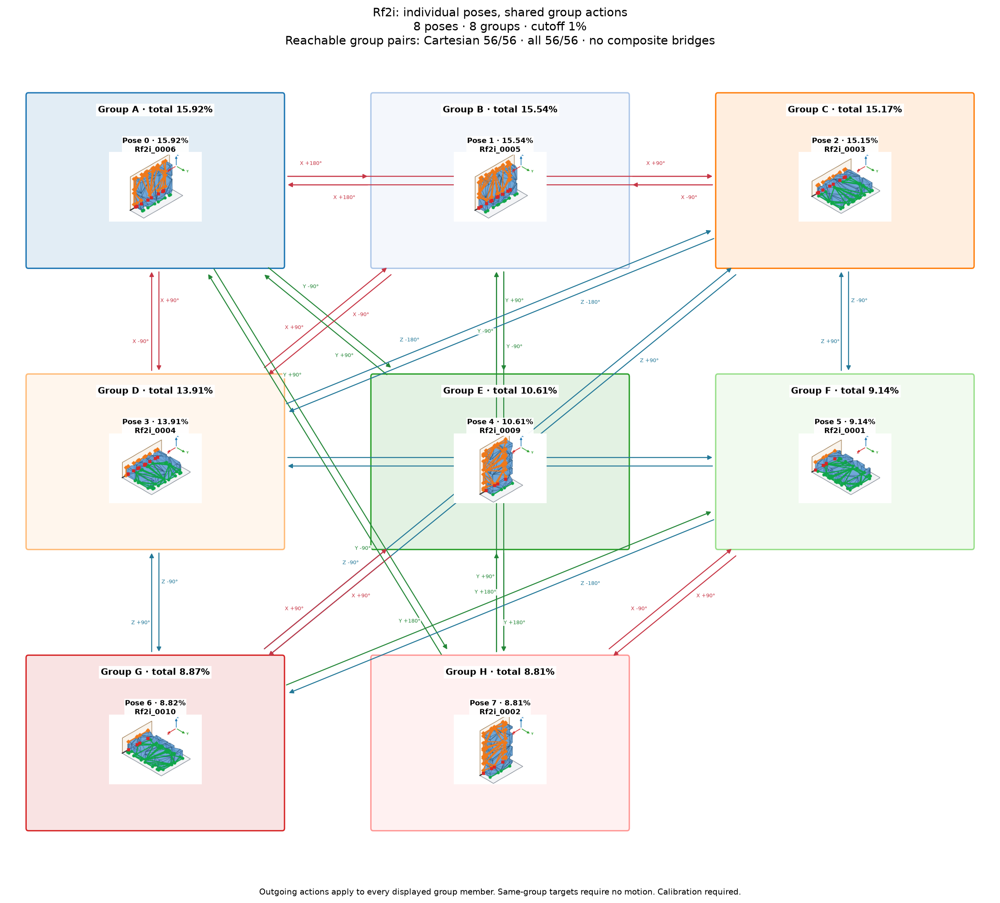

# Rf2i: individual poses with shared group actions

Cutoff: **1%**, applied separately to original group totals and individual observation frequencies. Exactly the cutoff qualifies; the source trial denominator is unchanged. Below-cutoff members are not displayed or used as witnesses. Groups without qualifying members are omitted.

| Pose | Original observation | Individual frequency | Count | Group |
| ---: | --- | ---: | ---: | --- |
| 0 | Rf2i_0006 | 15.92% | 1592 | A |
| 1 | Rf2i_0005 | 15.54% | 1554 | B |
| 2 | Rf2i_0003 | 15.15% | 1515 | C |
| 3 | Rf2i_0004 | 13.91% | 1391 | D |
| 4 | Rf2i_0009 | 10.61% | 1061 | E |
| 5 | Rf2i_0001 | 9.14% | 914 | F |
| 6 | Rf2i_0010 | 8.82% | 882 | G |
| 7 | Rf2i_0002 | 8.81% | 881 | H |

8 individual poses in 8 groups. Candidate group reachability: **56/56**; Cartesian-only: **56/56**.

Every outgoing action applies to all displayed members of its source group; any qualifying destination member satisfies its target group. A target in the current group requires no motion. There are no internal group transitions and no composite fallback bridges. Ordinary multi-step routes use retained single-axis actions. Disconnected components remain disconnected.

Commands, witnesses, competing landing outcomes, previews and finished routes are in consumer-export version 3. Poses are numbered by individual frequency; stable group identities are separate. Previews use actual witnesses and invent no internal movement. Contact feasibility and settling reliability remain unverified; assigned pressure profiles and explicit source-group calibration are required.

Original observations and memberships remain in `source/`. Historical exports are preserved under `history/` for explicit, hash-checked reimport; numeric group IDs must never be interpreted as new pose IDs. Existing recognition models continue to identify groups. See `manifest.json` and `files.sha256.json`.

The roadmap uses alphabetic group labels in row order (A–Z, then AA onward), numeric pose labels, and straight arrows.
