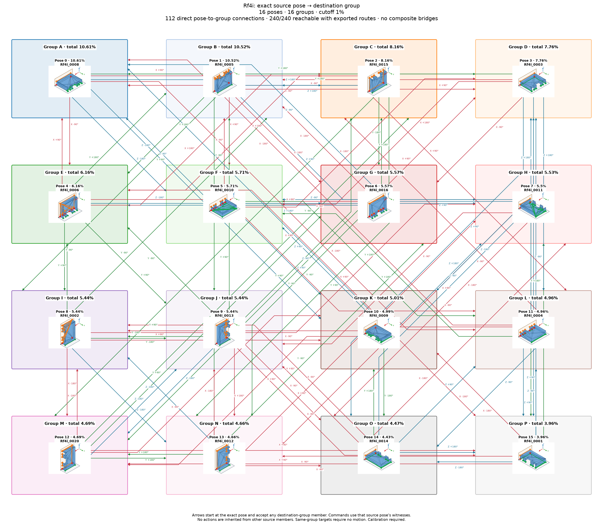

# Rf4i: exact source pose to destination group

Cutoff: **1%**, applied separately to original group totals and individual observation frequencies. Exactly the cutoff qualifies; the source trial denominator is unchanged. Below-cutoff members are not displayed or used as witnesses. Groups without qualifying members are omitted.

| Pose | Original observation | Individual frequency | Count | Group |
| ---: | --- | ---: | ---: | --- |
| 0 | Rf4i_0008 | 10.61% | 1061 | A |
| 1 | Rf4i_0005 | 10.52% | 1052 | B |
| 2 | Rf4i_0015 | 8.16% | 816 | C |
| 3 | Rf4i_0003 | 7.76% | 776 | D |
| 4 | Rf4i_0006 | 6.16% | 616 | E |
| 5 | Rf4i_0010 | 5.71% | 571 | F |
| 6 | Rf4i_0016 | 5.57% | 557 | G |
| 7 | Rf4i_0011 | 5.5% | 550 | H |
| 8 | Rf4i_0002 | 5.44% | 544 | I |
| 9 | Rf4i_0013 | 5.44% | 544 | J |
| 10 | Rf4i_0009 | 4.99% | 499 | K |
| 11 | Rf4i_0004 | 4.96% | 496 | L |
| 12 | Rf4i_0020 | 4.69% | 469 | M |
| 13 | Rf4i_0012 | 4.66% | 466 | N |
| 14 | Rf4i_0014 | 4.43% | 443 | O |
| 15 | Rf4i_0001 | 3.96% | 396 | P |

16 individual poses in 16 groups. Exact-source pose-to-group reachability: **240/240**; **112** pairs have direct candidates.

Each transition starts at an exact individual pose and accepts any qualifying member of its destination group. Actions from other source members are not inherited. A target in the current group requires no motion. There are no internal group transitions and no composite fallback bridges. Routes continue automatically only through singleton arrival groups; a multi-member arrival requires another exact pose observation. Disconnected components remain disconnected.

Commands, witnesses, competing landing outcomes, previews and finished routes are in consumer-export version 3. Poses are numbered by individual frequency; stable group identities are separate. Previews use actual witnesses and invent no internal movement. Contact feasibility and settling reliability remain unverified; assigned pressure profiles and explicit source-group calibration are required.

Original observations and memberships remain in `source/`. Historical exports are preserved under `history/` for explicit, hash-checked reimport; numeric group IDs must never be interpreted as new pose IDs. Existing recognition models continue to identify groups. See `manifest.json` and `files.sha256.json`.

The roadmap uses alphabetic group labels in row order (A–Z, then AA onward), numeric pose labels, and horizontal, vertical or 45° arrow segments. Arrows attach to pose borders and destination-group borders.

Changed export hashes require explicit reimport. Former group-wide choices need fresh exact-source qualification. The previous export is preserved in `history/before_pose_to_group_74fcb40.json.gz`.
