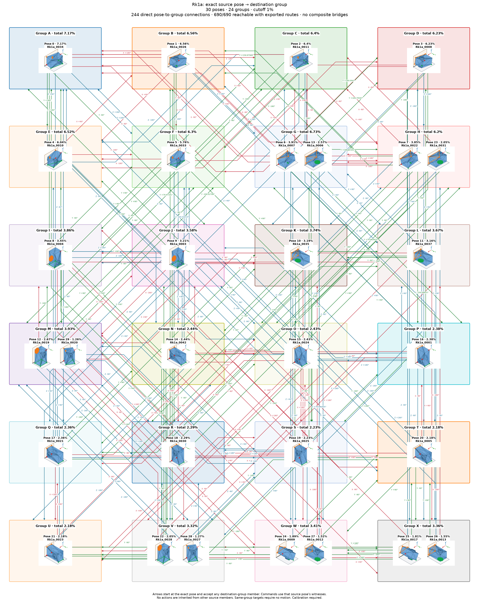

# Rk1a: individual poses with shared group actions

Cutoff: **1%**, applied separately to original group totals and individual observation frequencies. Exactly the cutoff qualifies; the source trial denominator is unchanged. Below-cutoff members are not displayed or used as witnesses. Groups without qualifying members are omitted.

| Pose | Original observation | Individual frequency | Count | Group |
|---:|---|---:|---:|---:|
| 0 | Rk1a_0034 | 7.17% | 717 | 0 |
| 1 | Rk1a_0026 | 6.56% | 656 | 2 |
| 2 | Rk1a_0011 | 6.4% | 640 | 4 |
| 3 | Rk1a_0008 | 6.23% | 623 | 6 |
| 4 | Rk1a_0010 | 6.04% | 604 | 3 |
| 5 | Rk1a_0033 | 5.76% | 576 | 5 |
| 6 | Rk1a_0007 | 3.91% | 391 | 1 |
| 7 | Rk1a_0022 | 3.85% | 385 | 7 |
| 8 | Rk1a_0004 | 3.45% | 345 | 9 |
| 9 | Rk1a_0003 | 3.21% | 321 | 12 |
| 10 | Rk1a_0035 | 3.19% | 319 | 10 |
| 11 | Rk1a_0037 | 3.16% | 316 | 11 |
| 12 | Rk1a_0019 | 2.67% | 267 | 8 |
| 13 | Rk1a_0006 | 2.57% | 257 | 1 |
| 14 | Rk1a_0042 | 2.44% | 244 | 16 |
| 15 | Rk1a_0024 | 2.43% | 243 | 17 |
| 16 | Rk1a_0001 | 2.38% | 238 | 18 |
| 17 | Rk1a_0021 | 2.36% | 236 | 19 |
| 18 | Rk1a_0030 | 2.29% | 229 | 20 |
| 19 | Rk1a_0025 | 2.23% | 223 | 21 |
| 20 | Rk1a_0005 | 2.18% | 218 | 22 |
| 21 | Rk1a_0023 | 2.18% | 218 | 23 |
| 22 | Rk1a_0028 | 2.05% | 205 | 15 |
| 23 | Rk1a_0031 | 2.05% | 205 | 7 |
| 24 | Rk1a_0009 | 1.89% | 189 | 13 |
| 25 | Rk1a_0017 | 1.81% | 181 | 14 |
| 26 | Rk1a_0013 | 1.55% | 155 | 14 |
| 27 | Rk1a_0012 | 1.52% | 152 | 13 |
| 28 | Rk1a_0027 | 1.27% | 127 | 15 |
| 29 | Rk1a_0020 | 1.26% | 126 | 8 |

30 individual poses in 24 groups. Candidate group reachability: **552/552**; Cartesian-only: **552/552**.

Every outgoing action applies to all displayed members of its source group; any qualifying destination member satisfies its target group. A target in the current group requires no motion. There are no internal group transitions and no composite fallback bridges. Ordinary multi-step routes use retained single-axis actions. Disconnected components remain disconnected.

Commands, witnesses, competing landing outcomes, previews and finished routes are in consumer-export version 3. Poses are numbered by individual frequency; stable group identities are separate. Previews use actual witnesses and invent no internal movement. Contact feasibility and settling reliability remain unverified; assigned pressure profiles and explicit source-group calibration are required.

Original observations and memberships remain in `source/`. Historical exports are preserved under `history/` for explicit, hash-checked reimport; numeric group IDs must never be interpreted as new pose IDs. Existing recognition models continue to identify groups. See `manifest.json` and `files.sha256.json`.
