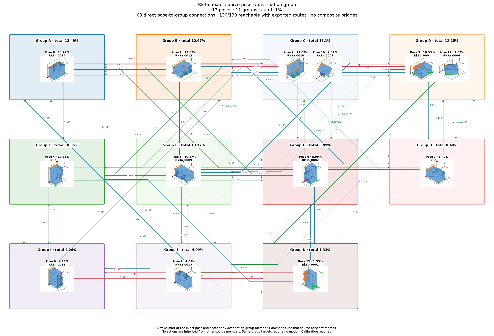

# Rk3a: exact source pose to destination group

Cutoff: **1%**, applied separately to original group totals and individual observation frequencies. Exactly the cutoff qualifies; the source trial denominator is unchanged. Below-cutoff members are not displayed or used as witnesses. Groups without qualifying members are omitted.

| Pose | Original observation | Individual frequency | Count | Group |
| ---: | --- | ---: | ---: | --- |
| 0 | Rk3a_0014 | 13.49% | 1349 | A |
| 1 | Rk3a_0012 | 12.67% | 1267 | B |
| 2 | Rk3a_0010 | 11.09% | 1109 | C |
| 3 | Rk3a_0004 | 10.53% | 1053 | D |
| 4 | Rk3a_0003 | 10.35% | 1035 | E |
| 5 | Rk3a_0009 | 10.27% | 1027 | F |
| 6 | Rk3a_0002 | 8.99% | 899 | G |
| 7 | Rk3a_0008 | 8.49% | 849 | H |
| 8 | Rk3a_0011 | 4.26% | 426 | I |
| 9 | Rk3a_0013 | 4.09% | 409 | J |
| 10 | Rk3a_0007 | 2.01% | 201 | C |
| 11 | Rk3a_0006 | 1.62% | 162 | D |
| 12 | Rk3a_0001 | 1.33% | 133 | K |

13 individual poses in 11 groups. Exact-source pose-to-group reachability: **130/130**; **68** pairs have direct candidates.

Each transition starts at an exact individual pose and accepts any qualifying member of its destination group. Actions from other source members are not inherited. A target in the current group requires no motion. There are no internal group transitions and no composite fallback bridges. Routes continue automatically only through singleton arrival groups; a multi-member arrival requires another exact pose observation. Disconnected components remain disconnected.

Commands, witnesses, competing landing outcomes, previews and finished routes are in consumer-export version 3. Poses are numbered by individual frequency; stable group identities are separate. Previews use actual witnesses and invent no internal movement. Contact feasibility and settling reliability remain unverified; assigned pressure profiles and explicit source-group calibration are required.

Original observations and memberships remain in `source/`. Historical exports are preserved under `history/` for explicit, hash-checked reimport; numeric group IDs must never be interpreted as new pose IDs. Existing recognition models continue to identify groups. See `manifest.json` and `files.sha256.json`.

The roadmap uses alphabetic group labels in row order (A–Z, then AA onward), numeric pose labels, and horizontal, vertical or 45° arrow segments. Arrows attach to pose borders and destination-group borders.

Changed export hashes require explicit reimport. Former group-wide choices need fresh exact-source qualification. The previous export is preserved in `history/before_pose_to_group_74fcb40.json.gz`.
