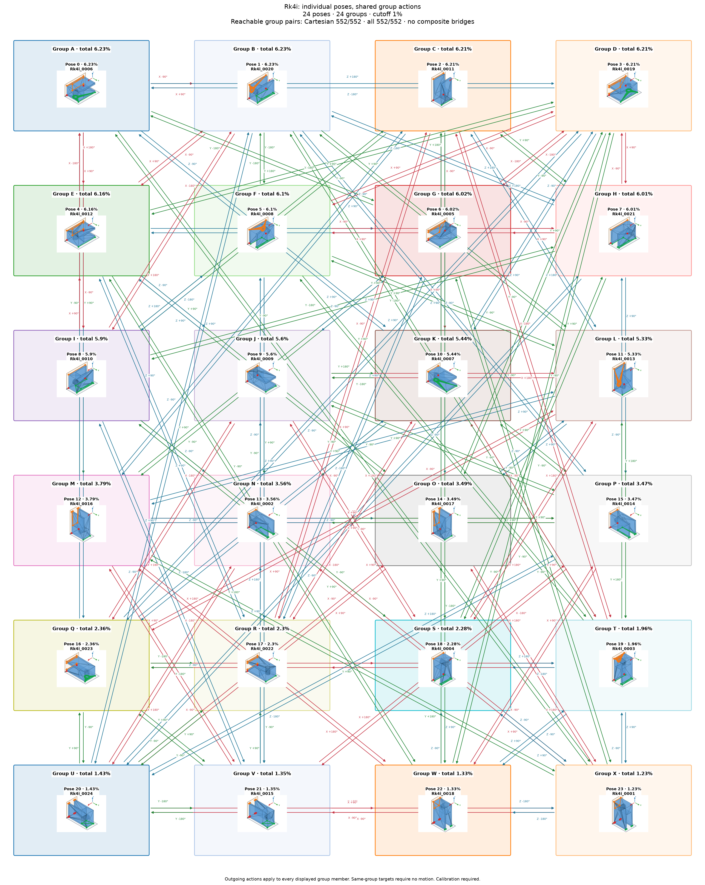

# Rk4i: individual poses with shared group actions

Cutoff: **1%**, applied separately to original group totals and individual observation frequencies. Exactly the cutoff qualifies; the source trial denominator is unchanged. Below-cutoff members are not displayed or used as witnesses. Groups without qualifying members are omitted.

| Pose | Original observation | Individual frequency | Count | Group |
|---:|---|---:|---:|---:|
| 0 | Rk4i_0006 | 6.23% | 623 | 0 |
| 1 | Rk4i_0020 | 6.23% | 623 | 1 |
| 2 | Rk4i_0011 | 6.21% | 621 | 2 |
| 3 | Rk4i_0019 | 6.21% | 621 | 3 |
| 4 | Rk4i_0012 | 6.16% | 616 | 4 |
| 5 | Rk4i_0008 | 6.1% | 610 | 5 |
| 6 | Rk4i_0005 | 6.02% | 602 | 6 |
| 7 | Rk4i_0021 | 6.01% | 601 | 7 |
| 8 | Rk4i_0010 | 5.9% | 590 | 8 |
| 9 | Rk4i_0009 | 5.6% | 560 | 9 |
| 10 | Rk4i_0007 | 5.44% | 544 | 10 |
| 11 | Rk4i_0013 | 5.33% | 533 | 11 |
| 12 | Rk4i_0016 | 3.79% | 379 | 12 |
| 13 | Rk4i_0002 | 3.56% | 356 | 13 |
| 14 | Rk4i_0017 | 3.49% | 349 | 14 |
| 15 | Rk4i_0014 | 3.47% | 347 | 15 |
| 16 | Rk4i_0023 | 2.36% | 236 | 16 |
| 17 | Rk4i_0022 | 2.3% | 230 | 17 |
| 18 | Rk4i_0004 | 2.28% | 228 | 18 |
| 19 | Rk4i_0003 | 1.96% | 196 | 19 |
| 20 | Rk4i_0024 | 1.43% | 143 | 20 |
| 21 | Rk4i_0015 | 1.35% | 135 | 21 |
| 22 | Rk4i_0018 | 1.33% | 133 | 22 |
| 23 | Rk4i_0001 | 1.23% | 123 | 23 |

24 individual poses in 24 groups. Candidate group reachability: **552/552**; Cartesian-only: **552/552**.

Every outgoing action applies to all displayed members of its source group; any qualifying destination member satisfies its target group. A target in the current group requires no motion. There are no internal group transitions and no composite fallback bridges. Ordinary multi-step routes use retained single-axis actions. Disconnected components remain disconnected.

Commands, witnesses, competing landing outcomes, previews and finished routes are in consumer-export version 3. Poses are numbered by individual frequency; stable group identities are separate. Previews use actual witnesses and invent no internal movement. Contact feasibility and settling reliability remain unverified; assigned pressure profiles and explicit source-group calibration are required.

Original observations and memberships remain in `source/`. Historical exports are preserved under `history/` for explicit, hash-checked reimport; numeric group IDs must never be interpreted as new pose IDs. Existing recognition models continue to identify groups. See `manifest.json` and `files.sha256.json`.
