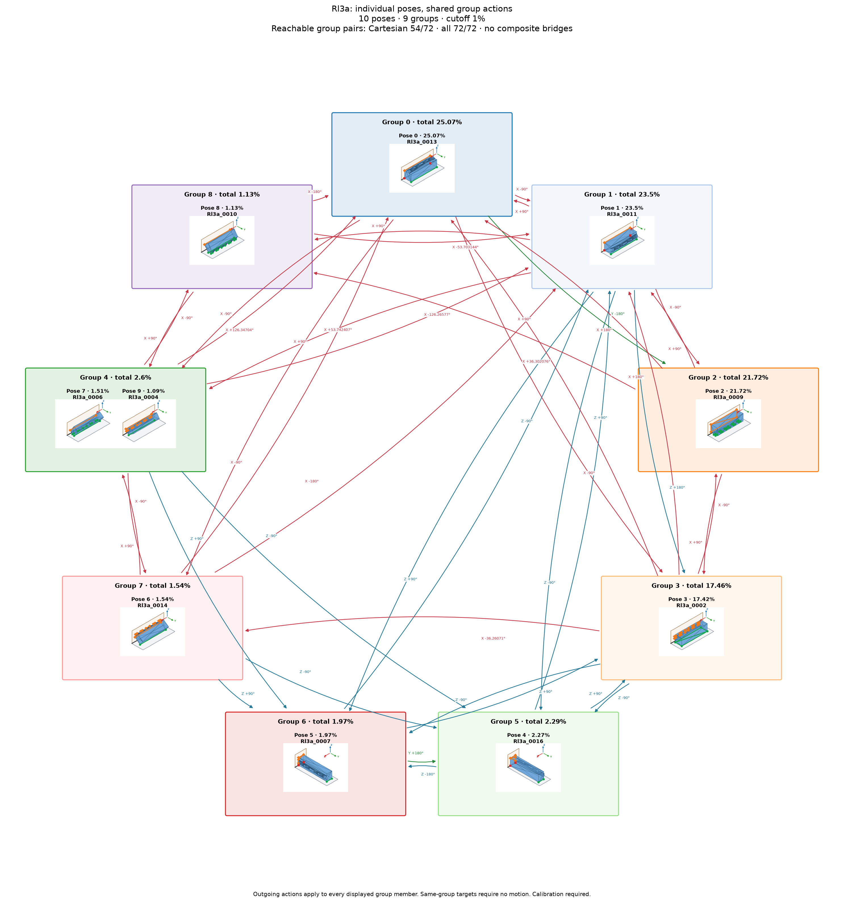

# Rl3a: individual poses with shared group actions

Cutoff: **1%**, applied separately to original group totals and individual observation frequencies. Exactly the cutoff qualifies; the source trial denominator is unchanged. Below-cutoff members are not displayed or used as witnesses. Groups without qualifying members are omitted.

| Pose | Original observation | Individual frequency | Count | Group |
|---:|---|---:|---:|---:|
| 0 | Rl3a_0013 | 25.07% | 2507 | 0 |
| 1 | Rl3a_0011 | 23.5% | 2350 | 1 |
| 2 | Rl3a_0009 | 21.72% | 2172 | 2 |
| 3 | Rl3a_0002 | 17.42% | 1742 | 3 |
| 4 | Rl3a_0016 | 2.27% | 227 | 5 |
| 5 | Rl3a_0007 | 1.97% | 197 | 6 |
| 6 | Rl3a_0014 | 1.54% | 154 | 7 |
| 7 | Rl3a_0006 | 1.51% | 151 | 4 |
| 8 | Rl3a_0010 | 1.13% | 113 | 8 |
| 9 | Rl3a_0004 | 1.09% | 109 | 4 |

10 individual poses in 9 groups. Candidate group reachability: **72/72**; Cartesian-only: **54/72**.

Every outgoing action applies to all displayed members of its source group; any qualifying destination member satisfies its target group. A target in the current group requires no motion. There are no internal group transitions and no composite fallback bridges. Ordinary multi-step routes use retained single-axis actions. Disconnected components remain disconnected.

Commands, witnesses, competing landing outcomes, previews and finished routes are in consumer-export version 3. Poses are numbered by individual frequency; stable group identities are separate. Previews use actual witnesses and invent no internal movement. Contact feasibility and settling reliability remain unverified; assigned pressure profiles and explicit source-group calibration are required.

Original observations and memberships remain in `source/`. Historical exports are preserved under `history/` for explicit, hash-checked reimport; numeric group IDs must never be interpreted as new pose IDs. Existing recognition models continue to identify groups. See `manifest.json` and `files.sha256.json`.
